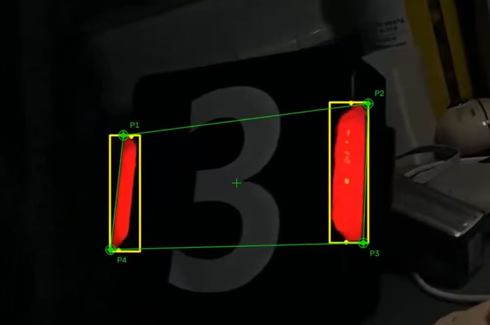
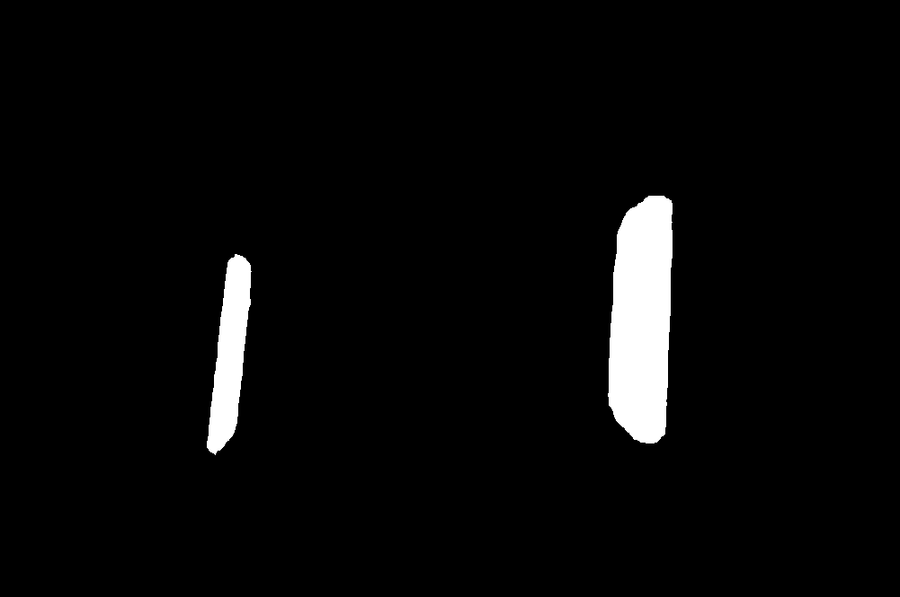

# hsv_demo —— 红色灯条 HSV 阈值分割演示

用 OpenCV 的 HSV 双区间阈值，把 RoboMaster 装甲板上的**红色灯条**从图片里"抠"出来，输出一张黑白掩膜图，用于**快速验证和调参** `inRange` 的颜色范围。

这是后续 `detect_demo`（灯条配对 → 装甲板检测）的**前置调试步骤**：掩膜对了，后面的轮廓、配对才有意义。

| 输入 | 输出 |
| :--: | :--: |
|  |  |

---

## 1. 目录结构

```
hsv_demo/
├── main.cpp          # 全部逻辑（约 45 行）
├── CMakeLists.txt    # CMake 构建脚本
├── armor.jpg         # 输入图片：红色灯条的装甲板（1001×665）
├── red_mask.png      # 运行后生成的输出掩膜
├── README.md
└── build/            # CMake 生成的构建目录（可删除重建）
    ├── Release/hsv_demo.exe
    └── ...
```

## 2. 环境要求

| 项目 | 要求 |
| --- | --- |
| 操作系统 | Windows（示例基于 MSVC；Linux 下改链接方式亦可） |
| OpenCV | 4.x / 5.x（本仓库已在 **5.0.0** 上编译运行通过） |
| 编译器 | 支持 C++17；本仓库用 Visual Studio 18 2026 生成器编译，链接 vc16 版 OpenCV（二进制兼容） |
| 构建工具 | CMake ≥ 3.16 |
| 其他 | 需要**桌面环境**，因为用到了 `imshow` 弹窗 |

OpenCV 依赖由 `CMakeLists.txt` 中的 `find_package(OpenCV REQUIRED)` 提供，并优先读取环境变量 `OpenCV_DIR`：

```cmake
if(DEFINED ENV{OpenCV_DIR})
    set(OpenCV_DIR $ENV{OpenCV_DIR})
endif()
```

## 3. 编译

在 `hsv_demo` 目录下执行：

```powershell
# 1) 指向本机 OpenCV 的 cmake 配置目录（按自己的安装路径修改）
$env:OpenCV_DIR = "D:\Code\OpenCV\opencv\build\x64\vc16\lib"

# 2) 配置 + 生成工程（Visual Studio 生成器）
cmake -S . -B build -A x64

# 3) 编译 Release 版本
cmake --build build --config Release
```

生成的可执行文件位于：

```
hsv_demo\build\Release\hsv_demo.exe
```

> 也支持在 VS Code / Visual Studio 中直接打开 `build\hsv_demo.slnx` 后编译运行。

## 4. 运行

⚠️ **程序里图片路径是写死的相对路径 `armor.jpg`**，所以**工作目录必须是 `armor.jpg` 所在目录**，否则会提示读取失败。

```powershell
cd hsv_demo
.\build\Release\hsv_demo.exe
```

运行后：

1. 弹出两个窗口：`Original`（原图）和 `Red Mask`（提取结果）；
2. 同时在**当前工作目录**写出 `red_mask.png`；
3. 在控制台打印提示，按**任意键**关闭窗口并退出。

> 若从 `build\Release` 目录直接双击 exe，当前目录里没有 `armor.jpg`，就会得到
> `无法读取图片，请确认 armor.jpg 是否在当前目录！`（退出码 `-1`）。

## 5. 处理流程

`main.cpp` 的流程非常线性：

| 步骤 | 代码 | 说明 |
| --- | --- | --- |
| ① 读图 | `imreadUnicode("armor.jpg")` | 先 `fopen` 读二进制，再 `cv::imdecode`，从而**兼容含中文的路径**（`cv::imread` 在 Windows + 中文路径下会失败） |
| ② 转色彩空间 | `cvtColor(img, hsv, COLOR_BGR2HSV)` | OpenCV 的 H 范围为 **0–180**（非 0–360），S/V 为 0–255 |
| ③ 低色相段 | `inRange(hsv, (0,100,70), (10,255,255), mask1)` | 红在色环上跨 0°，需分两段 |
| ④ 高色相段 | `inRange(hsv, (170,100,70), (180,255,255), mask2)` | 补上 170–180 这一段 |
| ⑤ 合并 | `bitwise_or(mask1, mask2, mask)` | 两段结果取或，得到完整红色区域 |
| ⑥ 闭运算 | `morphologyEx(mask, MORPH_CLOSE, 3×3 矩形核)` | 填补灯条内部的空洞、连接断裂 |
| ⑦ 输出 | `imwrite("red_mask.png", mask)` + `imshow` | 保存掩膜并显示 |

### 为什么红色要分两段？

HSV 色相是环形的，红色位于 0° 附近，跨越了数值边界。单一区间要么丢掉偏紫的红（>170），要么丢掉偏橙的红（<10）。因此用 `[0,10] ∪ [170,180]` 两段再合并，才能把整条灯条完整提出来。

## 6. 参数说明

阈值集中在两行 `inRange` 里，调参只改这里：

| 参数 | 当前值 | 含义 | 调大的效果 | 调小的效果 |
| --- | --- | --- | --- | --- |
| H 下限（低段） | `0` | 红色起始色相 | — | 会漏掉偏橙的灯 |
| H 上限（低段） | `10` | 低段终点 | 更宽容纳橙红 | 灯条边缘缺失 |
| H 下限（高段） | `170` | 高段起点 | 只留更"紫"的红 | 灯条偏亮端缺失 |
| H 上限（高段） | `180` | 色相上界（固定） | — | — |
| S 下限 | `100` | 最小饱和度 | 排除发白/反光区域 | 混入更多杂色 |
| V 下限 | `70` | 最小亮度 | 抑制暗部噪声 | 暗处的灯条易被丢弃 |
| 结构元尺寸 | `3×3` | 闭运算核大小 | 空洞填得更狠，但可能粘连 | 细缝填不上 |

**经验调法**：先只调 `V 下限`（光照影响最大），再看 `S 下限`（反光/过曝），最后用 `H` 两端修灯条轮廓。

## 7. 如何判断掩膜"对了"

打开 `red_mask.png`，检查：

- ✅ 两条灯条应该是**连续的、发白的实心竖条**；
- ✅ 装甲板中心数字、背景、机械结构应该**全黑**；
- ❌ 灯条断成几截 → 闭运算核调大（如 `Size(5,5)`）或降低 `S/V` 下限；
- ❌ 背景出现大片白色 → 提高 `S`、`V` 下限，或收窄 `H` 区间；
- ❌ 灯条只剩一条 → 多半是偏紫的那段（170–180）没覆盖到，检查 `H 下限（高段）`。

## 8. 常见问题

| 现象 | 原因 / 解决办法 |
| --- | --- |
| `无法读取图片…` | 工作目录不对。先 `cd hsv_demo` 再运行，或把 `armor.jpg` 复制到 exe 旁边 |
| 窗口一闪而过 / 无窗口 | 当前会话没有桌面（SSH、CI 容器）。可注释掉 `imshow`/`waitKey`，只保留 `imwrite` |
| 中文路径读不到 | 本 demo 已用 `imreadUnicode` 规避；**不要**改回 `cv::imread` |
| CMake 找不到 OpenCV | 未设置 `OpenCV_DIR`，或路径指向 `build` 而非 `build/x64/vc16/lib`（`OpenCVConfig.cmake` 所在目录） |
| 乱码 / 链接错误 | 位数不匹配：x64 程序必须链接 x64 的 OpenCV |

## 9. 已知限制

- 只处理**一张静态图**，不做视频/摄像头输入；
- 只针对**红色**灯条，蓝方/橙色需改阈值区间；
- 阈值是硬编码常量，换光照、换场地需重新调参（这也是本 demo 存在的意义——先验证再进 pipeline）；
- `imwrite` 的返回值未检查，磁盘只读或路径无权限时不会报错。

---

**下一步**：掩膜调好后，可直接进入 [`detect_demo`](../detect_demo/README.md)，它复用同一套 HSV 阈值，并在此基础上做轮廓 → 灯条筛选 → 左右配对 → 装甲板框选。
